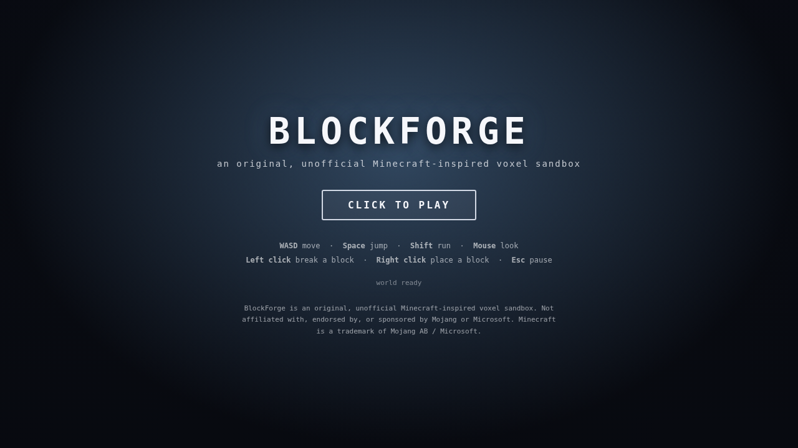

# BlockForge

> BlockForge is an original, unofficial Minecraft-inspired voxel sandbox.
> Not affiliated with, endorsed by, or sponsored by Mojang or Microsoft.
> Minecraft is a trademark of Mojang AB / Microsoft.

BlockForge is a Minecraft clone inspired by Minecraft. It is a first-person voxel sandbox:
procedurally generated terrain you can walk through, mine, and build in. It is built from scratch
in TypeScript and Three.js, with no engine, no framework, and no art assets — every texture is
generated procedurally in a canvas at runtime, and every sound is synthesised with WebAudio.

---

## Status

**Milestone 1 (M1 — Engine) is in progress.** This section is the honest one: what works
*right now*, and what does not. Nothing below is aspirational.



### Implemented

- **Seeded, deterministic world generation.** A chunked 16 × 16 × 256 voxel world with terrain
  produced by seeded noise. The same seed always produces a byte-identical world, in any order,
  in any process.
- **Own seeded PRNG.** A self-contained implementation — no RNG library, and no `Math.random`
  anywhere in the deterministic core.
- **Greedy meshing.** Chunk sections are meshed with stable vertex ordering, so meshing output is
  directly comparable in tests.
- **First-person renderer.** Three.js scene, lighting, pointer-lock camera, and a block highlight
  showing exactly what you are aiming at.
- **Procedural textures.** One generated 16×16 tile per block kind, drawn in a canvas at runtime.
  No image file is committed to this repository.
- **Synthesised sound.** WebAudio-generated footsteps, mining, placing and UI sounds. No audio
  file is committed to this repository.
- **HUD.** Crosshair, targeted-block readout, hotbar shell, health and hunger bars, and a
  pause/settings menu shell.
- **Movement and collision.** Gravity, jumping, and axis-separated AABB collision so you slide
  along walls rather than sticking to them.
- **Block breaking and placing.** Ray-marched targeting with a working break/place cycle.
- **Headless smoke test (gate G2).** A Playwright test that loads the real game in a headless
  browser, generates a world, breaks and re-places a block, and asserts the console stream carries
  **zero errors and zero warnings** for the whole session.
- **Determinism and purity test suite (gate G1).** 46 tests, 100% statement, branch, function and
  line coverage on `src/core/`.

### Not implemented yet

Do not expect these. They are future milestones, listed so nothing here reads as more finished
than it is:

- **Multiplayer.** The wire protocol and server-authoritative edit validation are not built. There
  is no server and no second player.
- **Crafting.** The crafting engine, recipes, and the crafting grid do not exist. The hotbar is an
  empty shell.
- **Mobs, combat, health, hunger as mechanics.** The HUD shows health and hunger bars because the
  layout is needed, but nothing drains them and nothing attacks you.
- **Item durability, tool tiers, and an inventory model.** The item stack type exists in the core
  contract; the behaviour does not.
- **Saving and loading.** No world persistence. Reloading the page generates a fresh world.
- **Sound effects beyond the basic set.** Ambience, music, and layered sound are absent.
- **Settings beyond a shell.** The menu has working sliders; nothing is persisted and most
  settings are not yet wired to behaviour.
- **Performance work.** No chunk streaming, no greedy meshing optimisation, no LOD, no frustum
  culling. Chunks are generated synchronously.
- **Mobile, touch controls, and accessibility options.** Desktop keyboard and mouse only.
- **Modding, and any form of user-supplied content.**

---

## Running it locally

Requires Node.js 24.22.0 (see `package.json` for the pinned toolchain versions).

```sh
npm install
npm run dev
```

Then open the URL Vite prints (by default <http://localhost:5173>).

### Controls

| Input | Action |
|---|---|
| `W` `A` `S` `D` | Move |
| `Space` | Jump |
| `Shift` | Move faster |
| Mouse | Look (click the canvas to capture the pointer) |
| Left click | Break the targeted block |
| Right click | Place a block |
| `F` | Break the targeted block (keyboard alternative) |
| `R` | Place a block (keyboard alternative) |
| `1`–`9` | Select a hotbar slot (slots are empty in M1) |
| `Esc` | Open or close the pause / settings menu |

---

## Running the tests

```sh
npm run test        # unit tests
npm run coverage    # unit tests + the 85% coverage floor on src/core (gate G1)
npm run test:e2e    # the Playwright headless smoke test (gate G2)
npm run typecheck   # tsc --noEmit
npm run lint        # ESLint
npm run build       # production bundle
```

`npm run coverage` **fails** if coverage on `src/core` drops below 85%. That failure is
intentional: it is gate G1.

`npm run test:e2e` needs a Playwright browser. Install it from *inside* the repository:

```sh
npx playwright install chromium
```

Running that command from outside the repo resolves a different global Playwright and installs a
mismatched browser build, and the launch then fails with "Executable doesn't exist".

---

## Project layout

```
src/core/      Pure deterministic core: types, constants, PRNG, world, meshing, physics.
               No DOM, no Three.js, no Math.random, no Date.now, no network.
src/engine/    Chunk store and worker orchestration.
src/render/    Everything Three.js, DOM, canvas and WebAudio.
src/gameplay/  Gameplay systems (inventory, hotbar, crafting).
src/net/       Client sync and the wire protocol.
server/        The authoritative server.
tests/         Unit tests. Owned exclusively by the test author.
e2e/           Playwright end-to-end tests. Gate G2.
scripts/       Build and asset-generation scripts.
docs/          Architecture, API reference, progress, blockers, victories.
```

The layering rule is enforced by a test, not by convention: `src/core/` may not import from
`src/engine/`, `src/render/`, `src/net/`, `src/gameplay/` or `server/`, and may not touch the DOM,
storage, the network, `Date`, or `performance`. It is the property the whole project rests on.

---

## Originality

Everything in this repository is original work.

- **No Mojang or Microsoft assets of any kind** — no textures, models, sounds, logos, fonts or
  music, and nothing decompiled or reverse-engineered.
- **No third-party art is committed.** Textures are generated procedurally in a canvas at runtime;
  sounds are synthesised with WebAudio. There is no binary art or audio in the repository.
- **Block, item and system names are BlockForge's own.** The vocabulary is deliberately reworded
  away from the well-known one — a log is "timber", leaves are "foliage", cobblestone is
  "rubble", diamond ore is "lumencrystal", and so on.
- The word "Minecraft" appears only in this README and in the docs, in the disclaimer sentence.
  It does not appear in the app title, the package name, the repo name, any class or identifier,
  or any in-game text.

Mechanics are a genre, and cloning mechanics is what this project does. Cloning *assets* is not.

---

## Licence

MIT. See `LICENSE`.

Third-party dependencies are used under their own licences; run `npm audit` for the current
advisory status.
